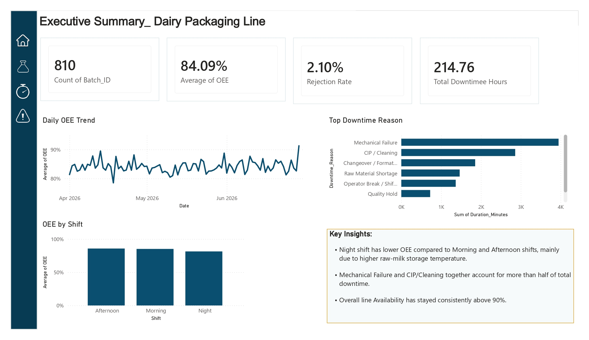
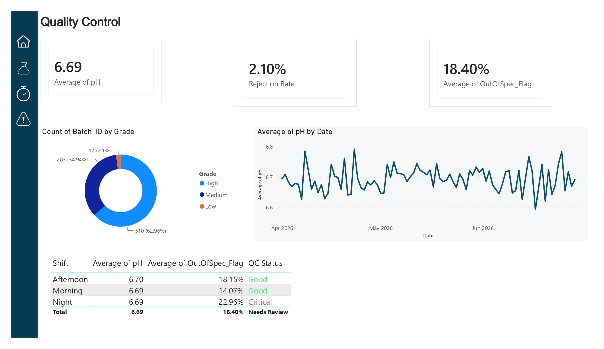
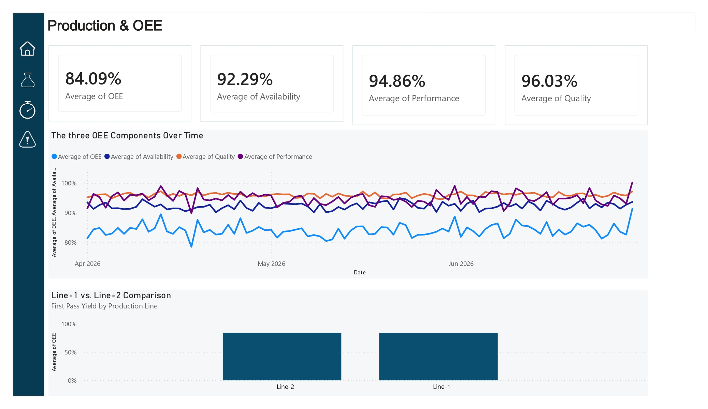
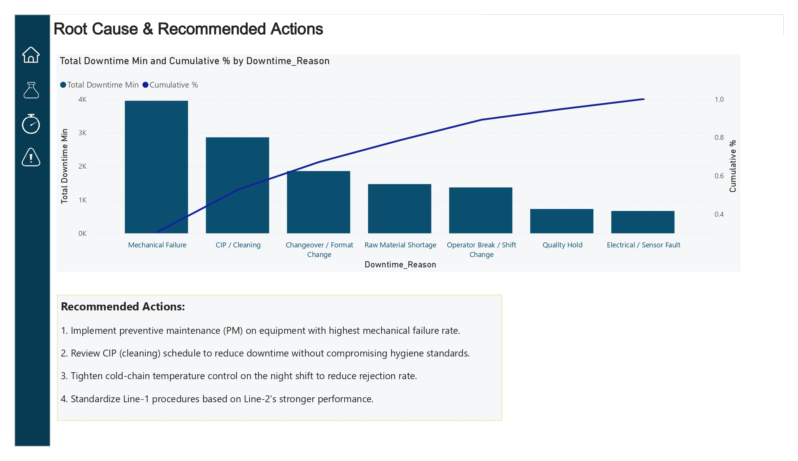

# 🥛 Dairy QC & Production Dashboard (Power BI)

A management dashboard built in Power BI to monitor product quality (QC) and production line performance in a dairy packaging plant — combining industry-standard KPIs with a Star Schema data model and DAX.

## 📊 Overview

This project simulates a real-world dairy production environment, tracking both product quality (lab test results per batch) and production efficiency (OEE) side by side — so management can see line health at a glance and drill into root causes.

The dashboard has 4 pages, connected through a custom icon-based sidebar for navigation:

| Page | What it shows |
|---|---|
| Executive Summary | OEE, First Pass Yield, Rejection Rate, Total Downtime, daily OEE trend, downtime Pareto, shift comparison, key insights |
| Quality Control | pH/temperature/fat trends, out-of-spec rate, quality grade distribution, shift-by-shift QC status |
| Production & OEE | Availability × Performance × Quality breakdown over time, Line-1 vs. Line-2 comparison |
| Root Cause & Action | Full Pareto analysis (bar + cumulative % line) of downtime reasons, data-driven recommended actions |

## 🖼️ Screenshots

## 📈 Key KPIs & DAX Measures

| KPI | Formula |
|---|---|
| OEE | Availability × Performance × Quality |
| First Pass Yield | Batches with Grade = High ÷ total batches |
| Rejection Rate | DIVIDE(CALCULATE(COUNTROWS(Fact_QC), Fact_QC[Grade]="Low"), COUNTROWS(Fact_QC)) |
| Out-of-Spec Rate | Average of OutOfSpec_Flag |
| Downtime Pareto | Cumulative % via RANKX + CALCULATE |

## 🗂️ Data Model

A Star Schema with:
- Dim_Date, Dim_Shift — dimension tables
- Fact_QC — 810 batch-level quality tests (pH, temperature, fat, turbidity, taste, odor, grade)
- Fact_Production — 540 shift/line records with Availability, Performance, Quality, OEE
- Fact_Downtime — downtime events with reason and duration

## 📦 Data Source

The dataset is modeled on the real structure, value ranges, and labeling logic of three public Kaggle datasets:
- [Milk Quality Prediction](https://www.kaggle.com/datasets/satishbanne/milk-quality-prediction)
- Production Quality (sensor dataset)
- Manufacturing Downtime / Efficiency dataset

Since no dairy plant publishes internal production data publicly, the data here is synthetically generated within realistic industry ranges to keep it valid for analysis — full documentation is in the included Excel file's ReadMe sheet.

## 🛠️ Tools & Skills Used

- Power BI Desktop — data modeling, DAX, visual design
- Power Query — data cleaning and transformation
- Microsoft Excel — raw data preparation
- DAX — custom measures (OEE, Rejection Rate, Pareto cumulative %)

## 📁 Repository Contents

- dairy-qc-dashboard.pbix — the full Power BI file
- dataset.xlsx — source data with documentation
- project-summary.docx — one-page project brief
- screenshots/ — dashboard page previews

## 🔍 Key Insight

Analysis revealed the night shift has a measurably lower First Pass Yield than morning/afternoon shifts, driven by elevated raw-milk storage temperature — leading to a concrete, data-backed recommendation for tighter cold-chain control.

## 👤 Author

Zoha Shirazi
Background: Food Tech | QC — dairy production and food coloring manufacturing

---
*This project was built as a portfolio piece to demonstrate Power BI, DAX, and data modeling skills applied to food industry quality control and production analytics.*
